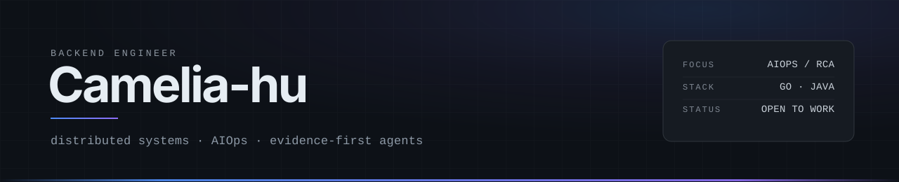

<!--
  GitHub 个人主页：这份 README 会渲染在 github.com/Camelia-hu。
  hero 和分隔线都是 assets/ 里的手写 SVG；整页不引任何第三方图片服务，外部站点挂掉也不会裂图。
  改配色时三处一起改：0D1117 / 4E8CF7 / 8E6EF7。
  这里只放技术身份：不写真实姓名、学校、公司名和私人邮箱。
-->

  

后端开发，Go 为主、Java 为辅。做过云数据库控制面的迁移与诊断、社交产品的 Feed 与榜单、AI 陪伴产品的实时语音与记忆——三种完全不同的负载形状。

现在主要精力在 **AIOps**：让 Agent 自己读指标、日志、链路和拓扑，把根因找出来；每条结论都绑定证据，可复现、可评测。

## 做过

| 方向 | 具体做了什么 |
| :--- | :--- |
| 云数据库控制面 | 跨可用区迁移工作流、集群变配适配、实例级 `HostAliases`、容器日志采集（线上通过率 >98%）、告警 → 抓日志 → 建单 → AI 分析的运维闭环 |
| 社交 Feed 流 | 帖子拉取与发布、多策略优先级冲突梳理、MongoDB 建模与异步计数、榜单生命周期与分页 |
| AI 陪伴 / 实时语音 | ASR 改全双工异步流式（2s → 1s）、三层记忆写入链路、Asynq 解耦耗时任务（60s → 20s，吞吐 +50%）、OpenTelemetry 链路追踪 |

## 项目

### OpsAgent — 告警驱动的 AIOps 根因诊断

`Go` · 2026 · 面向 SRE

接入指标 / 日志 / 链路 / 拓扑四类数据，打通「告警触发 → 多智能体取证 → 根因定位 → 结论回写」。核心不是"能答"，而是结论可复现、可量化评测。

- **多智能体 RCA** — 自研 ReAct 循环 + 协调者 / 专家双 Agent；按拓扑展开影响面，关联四类数据的异常，收敛到根因并绑定证据
- **告警侧治理** — `dedupe_key` 归并 + 状态机 + 静默冷却；有界 worker 池做背压，积压时丢任务而不是阻塞告警链路
- **多源取证** — PromQL / LogQL / TraceQL / 拓扑四类查询；源码检索固定 commit SHA，缺版本宁可报错也不回退 HEAD
- **工具治理与审批** — 装饰器链承载超时 / 审计 / 限流 / 审批；写操作在审批前封存闭包 + 一次性令牌，防重复执行
- **预算与状态恢复** — 并发调用前原子预占预算、只读同参复用；会话按 `tool_call_id` 重配对恢复

### feedsystem_video_go — 短视频 Feed 流

`Go` · `Gin` · `MySQL` · `Redis` · `RabbitMQ` · [源码](https://github.com/Camelia-hu/feedsystem_video_go-medium)

- **推拉混合扩散** — 按粉丝数阈值切分大 V 读扩散与普通作者写扩散
- **多级缓存** — 并做过一次有意的缓存击穿实验
- **热度衰减** — Redis ZSET 预乘时间权重，读时 O(log N) 取 TopK
- **微服务化** — 正在拆成 4 个服务上 kind 集群，配故障注入开关 + k6 压测对比

## 开源

**[ongrid](https://github.com/ongridio/ongrid)** · Go · AIOps Agent

围绕 IM 长连接的状态可见性：1 个 issue + 3 个 PR。

- [`#517`](https://github.com/ongridio/ongrid/issues/517) — 飞书长连接卡死会让所有 IM 应用停止调度，维护者采纳并修复
- [`#522`](https://github.com/ongridio/ongrid/pull/522) — 把 stream 运行状态透出到 Channels 页面：运行中 / 重连中 / 已停止 + 最后错误
- [`#537`](https://github.com/ongridio/ongrid/pull/537) — Slack 客户端取消不生效，关闭 socket 才能解阻
- [`#538`](https://github.com/ongridio/ongrid/pull/538) — 修 `#522` 里的状态抖动与时间戳反复重置

## 技术栈

| 方向 | 常用 |
| :--- | :--- |
| 语言 | `Go` `Java` `Python` `SQL` |
| 存储 | `MySQL` `Redis` `MongoDB` `Elasticsearch` |
| 中间件 | `NSQ` `Kafka` `RabbitMQ` `Asynq` |
| 云原生 | `Docker` `Kubernetes` `Helm` `kind` |
| 可观测 | `Prometheus` `Loki` `Tempo` `Grafana` `OpenTelemetry` |
| AI 工程 | `ReAct` `RAG` `Milvus` `Qdrant` `ASR` |

## 联系

  有想法直接开 issue 或 DM 
  <a href="https://github.com/Camelia-hu"><code>github.com/Camelia-hu</code></a>

